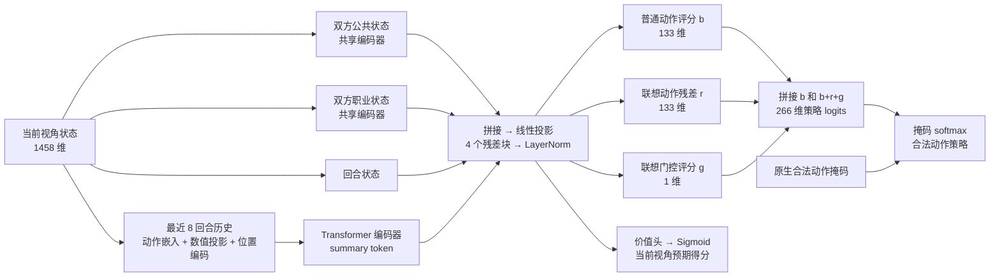

# blacksmith.cpp

C++20 规则引擎、原生 Python 绑定和 Master 神经网络自对弈训练。

## 目录

- `src/`：游戏规则及 C++ 双人终端客户端。
- `python/python-bindings/`：状态编码、批量环境、搜索分支及绑定。
- `python/src/master/models/`：网络定义与 checkpoint 加载。
- `python/src/master/train/`：自对弈、课程、搜索和 replay。
- `python/src/master/play.py`：本地人机对战与赛后复盘。
- `models/blacksmith-master/`：本地 Master 权重，默认使用 `master-0099.pt`。
- `out/build/native/`：本地 C++ 构建产物。
- `tests/`、`python/tests/`：规则、训练和 play 的回归测试。

## 模型架构



## 方法

C++ 负责规则、合法动作、状态编码和批量模拟；Python/PyTorch 负责网络、搜索与自对弈训练。状态包含双方公共和职业状态、回合信息及最近八回合历史；合法动作由原生引擎提供掩码。

针对双方同时行动，搜索在有限候选动作和深度内展开动作组合，使用 regret matching+ 近似求解局部收益矩阵。训练以搜索策略为策略目标、以折扣后的对局结果为价值目标，结合 replay 更新网络。

## 实验观察

以下为已有实验中的观察，具体模型版本、对局数量、实验配置和结果记录待整理补充：

- 历史存档对战：训练过程中定期与历史 checkpoint 对战。观察到充分训练的 AI 在不同席位和配置下交叉对战时胜率接近 50%，据此推测策略接近纳什均衡。
- 历史信息：引入 Transformer 的目标是利用历史信息改善对人表现。AI 对战中，屏蔽已训练模型的历史输入会明显降低其能力；加入历史信息后，AI 间胜率未见明显提高。
- 搜索：使用同一模型对战纯策略网络，单回合搜索在 400 局中取得 301 胜 99 负；两回合搜索取得 277 胜 102 负 21 和。单回合与两回合搜索直接对战 400 局，分别取得 204 胜和 186 胜、10 局和棋。实验配置、耗时和原始记录见[搜索评测](experiments/search/README.md)。
- 训练资源：训练环境使用 10 核 CPU 和 RTX 4090。据本地记录，`master-0099` 经自由自对弈和专项课程两个阶段累计训练约 58 分钟，完成 16,272 局和 8,928 次梯度更新。

约 10 位玩家各进行了约 5 场人机对战。对局过程观察显示，Zero 的选择更中性；Master 有时会预测对手的非理性选择并作出惩罚。

### 人类玩家双盲对战

两位玩家各进行 99 场对局，分别与最新版本 Master、Zero 和另一位玩家各对战 33 场，共计 198 场。每一局测试方提供固定对手的出招，被测方不知道本局面对哪位对手。两位玩家在各组中取得的胜利次数如下：

| 玩家 | 对 Master | 对 Zero | 对另一位玩家 |
|---|---:|---:|---:|
| 玩家 1 | 15 / 33 | 10 / 33 | 16 / 33 |
| 玩家 2 | 7 / 33 | 16 / 33 | 14 / 33 |

表中记录的是玩家的胜场。

## 构建

需要 Python 3.11、C++20 编译器、CMake、Ninja 和 uv。
Windows 运行 `build.cmd`，Linux 运行 `bash build.sh`。
当前 Master schema 为 8；此前的权重和课程数据需要重新生成。

当前启用八个职业；Monk、Prophet 暂时停用。规则见 [BlacksmithRuleCN.md](BlacksmithRuleCN.md)。

## 本地对战

```powershell
.\play.cmd
.\play.cmd --starting-iron 0 --search-depth 3 --width 24 --leaf-width 4
```

开局选择玩家的初始 iron；Master 始终从 0 开始。输入技能及参数，例如 `iron 0` 或 `association 0 magicattack 3`；`resign` 认输，`q` 退出。对局结束后可进入复盘，查看搜索推荐或从指定位置试玩。

界面显示的网络预测为预期得分（胜 1、负 0、和 0.5），包含训练时间折扣。详细操作见 [Master 文档](python/src/master/README.md)。

## 浏览器对战

构建后运行 `python/.venv/Scripts/python.exe server/app.py`（Windows）或 `bash server/start.sh`（Linux），然后打开服务器打印的地址。网络与部署说明见 [server/README.md](server/README.md)。

## 自对弈训练

```powershell
python/.venv/Scripts/python.exe -m master train --mode free --device cpu --hidden 256 --depth 4 --history-width 64 --history-layers 1 --history-heads 4 --output out/training
```

GPU 可用时改为 `--device cuda --precision bf16`。
`--max-seconds` 和 `--max-gradient-steps` 控制预算，`--resume PATH` 恢复权重与优化器，
`--initial PATH` 只载入权重。默认仅输出 checkpoint 和必要的训练进度、配置；
需要逐步对局记录时才加 `--record-games`。

网络、协议及参数见 [Master 文档](python/src/master/README.md)。
